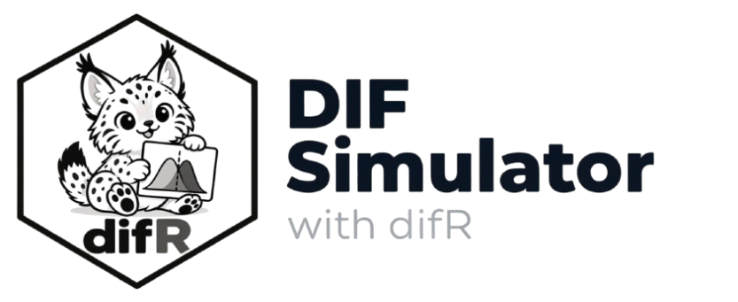

# User guide



## About this project

This DIF simulator is developed at the **Université de Montréal** as a pedagogical tool for teaching differential item functioning: it lets students and researchers generate simulated data with *known* DIF items, then watch how classical and modern detection methods perform against the ground truth.

The project is developed in collaboration with the team behind [Shiny Item Analysis](https://shiny.cs.cas.cz/ShinyItemAnalysis/) : an open-source interactive platform for psychometric analysis maintained by our colleagues at Charles University (Prague).

## What is DIF?

**Differential Item Functioning (DIF)** occurs when respondents from different groups (e.g. reference vs. focal) with the *same level of ability* have different probabilities of answering an item correctly. A DIF item is biased in the sense that it measures something else (or in addition to) the intended trait.

Two types of DIF:

- **Uniform DIF**: the difference between groups is constant across ability levels. In practice, the item is systematically easier for one group. Formally: a shift in the difficulty parameter *b*.
- **Non-uniform DIF**: the difference changes with ability — the item may even favour the reference group at low ability and the focal group at high ability. Formally: a change in the discrimination parameter *a*.

The distinction matters because some methods (e.g. MH) mostly detect uniform DIF, while others (e.g. logistic regression, Lord, Raju) can detect both.

## Data sources

### Simulated (dichotomous)

Responses are generated under a **2-parameter logistic (2PL) model**:

<div style="font-family:'Cambria Math','STIX Two Math',Georgia,serif; font-size:1.15em; margin:1em 0;">
P(X = 1 | θ) = 1 / (1 + e<sup>−a(θ − b)</sup>)
</div>

- **a**: item discrimination (slope)
- **b**: item difficulty
- **θ**: respondent ability, drawn from a normal distribution  
(reference: mean 0; focal: adjustable mean)

The **random seed** makes the simulation fully reproducible: same seed + same settings = same data.

### Simulated (polytomous)

Responses are generated under a **graded response model (GRM)**: the item score is the number of category thresholds crossed by the respondent, with

<div style="font-family:'Cambria Math','STIX Two Math',Georgia,serif; font-size:1.15em; margin:1em 0;">
P(X ≥ k | θ) = 1 / (1 + e<sup>−a(θ − b − s<sub>k</sub>)</sup>)
</div>

where **s<sub>k</sub>** is the k-th threshold. DIF is injected exactly as in the 2P case (**b** shift for uniform, **a** change for non-uniform).

### Upload your own data (CSV)

- One row per respondent, one column per item.
- Dichotomous items: coded 0/1. Polytomous items: coded 0 to (K-1).
- One column may code the group (e.g. 0 = reference, 1 = focal), otherwise  
respondents can be randomly split into two groups.
- Rows with missing values (NA) are removed automatically.

## Detection methods

<table style="border-collapse:collapse; width:95%; margin:1em 0;">
  <thead>
    <tr style="background-color:#e8e8e8; color:#333333; text-align:left;">
      <th style="padding:8px; border:1px solid #ccc;">Method</th>
      <th style="padding:8px; border:1px solid #ccc;">Item type</th>
      <th style="padding:8px; border:1px solid #ccc;">DIF type detected</th>
      <th style="padding:8px; border:1px solid #ccc;">Reference</th>
    </tr>
  </thead>
  <tbody>
    <tr><td style="padding:6px 8px; border:1px solid #ccc;">MH</td><td style="padding:6px 8px; border:1px solid #ccc;">Dichotomous</td><td style="padding:6px 8px; border:1px solid #ccc;">Mostly uniform</td><td style="padding:6px 8px; border:1px solid #ccc;">Mantel &amp; Haenszel (1959)</td></tr>
    <tr style="background-color:#f5f5f5;"><td style="padding:6px 8px; border:1px solid #ccc;">Logistic</td><td style="padding:6px 8px; border:1px solid #ccc;">Dichotomous</td><td style="padding:6px 8px; border:1px solid #ccc;">Uniform &amp; non-uniform</td><td style="padding:6px 8px; border:1px solid #ccc;">Swaminathan &amp; Rogers (1990)</td></tr>
    <tr><td style="padding:6px 8px; border:1px solid #ccc;">ILHTE</td><td style="padding:6px 8px; border:1px solid #ccc;">Dichotomous</td><td style="padding:6px 8px; border:1px solid #ccc;">Uniform &amp; non-uniform</td><td style="padding:6px 8px; border:1px solid #ccc;">Tuerlinckx &amp; De Boeck</td></tr>
    <tr style="background-color:#f5f5f5;"><td style="padding:6px 8px; border:1px solid #ccc;">Lord</td><td style="padding:6px 8px; border:1px solid #ccc;">Dichotomous</td><td style="padding:6px 8px; border:1px solid #ccc;">Uniform &amp; non-uniform</td><td style="padding:6px 8px; border:1px solid #ccc;">Lord (1980)</td></tr>
    <tr><td style="padding:6px 8px; border:1px solid #ccc;">Raju</td><td style="padding:6px 8px; border:1px solid #ccc;">Dichotomous</td><td style="padding:6px 8px; border:1px solid #ccc;">Uniform &amp; non-uniform</td><td style="padding:6px 8px; border:1px solid #ccc;">Raju (1988, 1990)</td></tr>
    <tr style="background-color:#f5f5f5;"><td style="padding:6px 8px; border:1px solid #ccc;">SIBTEST</td><td style="padding:6px 8px; border:1px solid #ccc;">Dichotomous</td><td style="padding:6px 8px; border:1px solid #ccc;">Uniform (and non-uniform variants)</td><td style="padding:6px 8px; border:1px solid #ccc;">Shealy &amp; Stout (1993)</td></tr>
    <tr><td style="padding:6px 8px; border:1px solid #ccc;">Std</td><td style="padding:6px 8px; border:1px solid #ccc;">Dichotomous</td><td style="padding:6px 8px; border:1px solid #ccc;">Uniform</td><td style="padding:6px 8px; border:1px solid #ccc;">Dorans &amp; Kulick (1986)</td></tr>
    <tr style="background-color:#f5f5f5;"><td style="padding:6px 8px; border:1px solid #ccc;">MantelPoly</td><td style="padding:6px 8px; border:1px solid #ccc;">Polytomous</td><td style="padding:6px 8px; border:1px solid #ccc;">Uniform &amp; non-uniform</td><td style="padding:6px 8px; border:1px solid #ccc;">Mantel (1963)</td></tr>
    <tr><td style="padding:6px 8px; border:1px solid #ccc;">Quade</td><td style="padding:6px 8px; border:1px solid #ccc;">Polytomous (experimentation with dichotomous)</td><td style="padding:6px 8px; border:1px solid #ccc;">Uniform &amp; non-uniform</td><td style="padding:6px 8px; border:1px solid #ccc;">Quade (1976)</td></tr>
    <tr style="background-color:#f5f5f5;"><td style="padding:6px 8px; border:1px solid #ccc;">PolyLogistic</td><td style="padding:6px 8px; border:1px solid #ccc;">Polytomous</td><td style="padding:6px 8px; border:1px solid #ccc;">Uniform &amp; non-uniform</td><td style="padding:6px 8px; border:1px solid #ccc;"></td></tr>
  </tbody>
</table>


**Alpha level**: significance threshold used to flag items.

**Iterative purification**: DIF items are removed from the matching score and the analysis is rerun until the set of flagged items stabilizes.

## Reading the outputs

- **Ground truth tab**: true item parameters by group, item characteristic curves (one curve per group; per category threshold in polytomous mode), score distributions, and a scatter plot of mean item scores (focal vs. reference). Points on the diagonal behave identically across groups; off-diagonal points are DIF suspects. Red = flagged by at least one method.
- **Detection tab**: verdict table (each method vs. the known truth for simulated data) and a summary of true positives, false positives and missed items per method.
- **Detailed outputs tab**: full raw difR output for each method.

## Try this

1. Generate dichotomous data with 3 uniform DIF items: compare MH and Lord.
2. Switch to non-uniform DIF and watch MH miss items that Logistic catches.
3. Set the focal group mean ability to 1.0 *without* any DIF ("impact"): notice that the score distributions differ but the scatter plot stays on the diagonal — group differences in ability are not DIF.

## Further reading

- Drabinová, A., & Martinková, P. (2018). Detection of differential item functioning with nonlinear regression: Non-IRT approach differs from logistic regression. *Acta Polytechnica*, 58, 208–215. (A comparative view from the ShinyItemAnalysis team — connects the two platforms of this collaboration.)

- Kim, S.-H., Cohen, A. S., & Park, T.-H. (1995). Detection of differential item functioning in multiple groups. *Journal of Educational Measurement*, 32, 261–276. (The generalized Lord's chi-square method included in difR.)

- Magis, D., Béland, S., & Raiche, G. (2015). Essentials to know and practise about DIF: A multi-step approach. *Tutorials in Quantitative Methods for Psychology*, 11, 157–166. (A short practical tutorial that walks through DIF analysis step by step —  
ideal companion to this app.)

- Magis, D., Béland, S., Tuerlinckx, F., & De Boeck, P. (2010). A general framework and an R package for the detection of dichotomous differential item functioning. *Behavior Research Methods*, 42, 847–862. doi:10.3758/BRM.42.3.847  
(The reference paper of the package — start here.)

- Magis, D., Raiche, G., Béland, S., & Gérard, P. (2011). A generalized logistic regression procedure to detect differential item functioning among multiple groups. *Journal of Educational and Behavioral Statistics*, 36, 525–552. (The generalized logistic method implemented in difR for multiple groups.)

## Cite this project

If you use this simulator in your teaching or research, please cite it as:

Caron, É., Béland, S., & Hladká, A. (2026). *DIF Simulator with difR:  An interactive tool for teaching differential item functioning*  [Computer software]. GitHub. https://github.com/emilecaron/dif-simulator

Or, in BibTeX format:

```bibtex
@software{difsimulator2026,
  title        = {{DIF Simulator with difR: An Interactive Tool for Teaching
                   Differential Item Functioning}},
  author       = {Caron, {\'E}mile and B{\'e}land, S{\'e}bastien and Hladk{\'a}, Ad{\'e}la},
  year         = {2026},
  url          = {https://github.com/emilecaron/dif-simulator},
  howpublished = {GitHub},
  note         = {Shiny application}
}
```

---

(c) 2026 Émile Caron, Sébastien Béland and Adéla Hladká. This app is released under the [WTFPL license](https://www.wtfpl.net/).